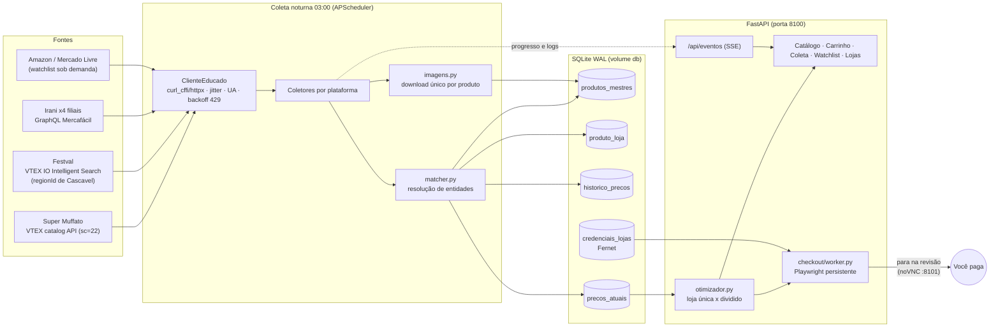
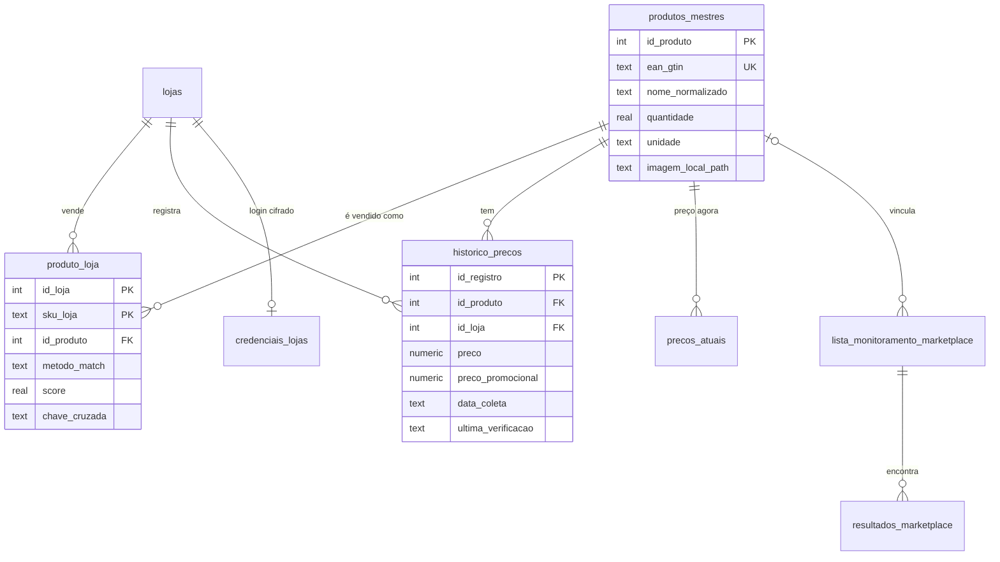

# Mercado Cascavel: agregador de preços local-first

Comparador de preços de supermercado de Cascavel-PR que roda inteiro em casa, num servidor doméstico
(Ryzen 3, só CPU). Toda madrugada ele coleta os catálogos das lojas, **unifica produtos idênticos sob um
único `id_produto`**, guarda a série histórica de preços e monta o carrinho mais barato, seja numa loja
só, seja dividido entre várias lojas já contando o frete. No fim, um robô abre as lojas, faz login, monta
os carrinhos e **para na tela de revisão/pagamento**. Quem paga é sempre o humano.

| | |
|---|---|
| **Engenharia de dados** | coleta incremental, SQLite WAL, série temporal com compressão por mudança, tabela materializada de preço atual |
| **Resolução de entidades** | EAN/GTIN com dígito verificador, chave de rede entre filiais, fuzzy com RapidFuzz e travas de unidade/marca/variante |
| **Scraping resiliente** | APIs JSON públicas (VTEX, VTEX IO Intelligent Search, GraphQL Mercafácil), jitter, backoff em 429, parada em bloqueio |
| **RPA** | Playwright com perfis persistentes, cofre Fernet, guarda de rede contra pagamento |
| **Produto** | FastAPI + HTMX + Alpine + Tailwind, SSE em tempo real, ~19 KB de CSS, zero CDN |

---

## Arquitetura



### Modelo de dados



* **`produtos_mestres`** é o catálogo canônico. Produto igual em lojas diferentes = **mesmo `id_produto`**.
* **`produto_loja`** liga o SKU de cada loja ao produto canônico e guarda *como* foi ligado (`ean`, `rede`,
  `fuzzy` com score, `novo`). Isso deixa a deduplicação auditável na tela do produto e acelera as coletas
  seguintes, porque um SKU já visto não passa pelo fuzzy de novo.
* **`historico_precos`** é a série temporal. Para não inflar o banco (~10 mil itens × 7 lojas × 365 dias), uma
  linha nova só nasce quando preço, promoção ou disponibilidade **mudam**. Coletas que confirmam o mesmo
  preço só avançam `ultima_verificacao`. O histórico continua exato e cresce na velocidade das mudanças.
* **`precos_atuais`** é uma tabela materializada (mantida em `registrar_preco`) para o catálogo não fazer
  `MAX(id)` sobre a série inteira a cada busca.

## Resolução de entidades (`app/matcher.py`)

Cada item coletado percorre uma cascata. A primeira regra que resolve encerra:

| Ordem | Regra | Por quê |
|---|---|---|
| 0 | **SKU já vinculado** nesta loja | idempotência: a 2ª coleta não refaz o trabalho |
| 0b | **Chave de rede** (`mercafacil:<modelId>`) | as 4 filiais Irani não expõem EAN, mas o `modelId` é o mesmo nelas |
| 1 | **EAN/GTIN exato**, validado pelo dígito verificador e normalizado (GTIN-14 → 13) | identificador global; PLU de balança (ex.: "1311") é descartado |
| 2 | **Fuzzy** = média de `token_sort_ratio` e `token_set_ratio` do RapidFuzz **≥ 88** | nomes de gôndola variam ("Café Torrado e Moído Baggio Gourmet 500g" × "CAFE BAGGIO GOURMET 500G") |
| 3 | senão, **produto novo** (e a imagem é baixada nesse momento, uma única vez) | |

O fuzzy só compara candidatos do **mesmo bloco de medida**. O bloco é a tupla `(pacote, valor, unidade)`,
normalizada para g, ml, m ou un: `500g ≠ 1kg ≠ 2x500g`, e `12 rolos 30m ≠ 4 rolos 30m`. Isso é a
**validação estrita de peso/volume**, e também reduz o espaço de busca (blocking). Mesmo acima de 88%, o
match é recusado quando:

* os dois lados têm EAN e eles são **diferentes**;
* as **marcas** divergem;
* os **números** do nome divergem ("3 em 1" × "2 em 1");
* os **descritores de variante** divergem (integral/desnatado, zero/diet, neutro/limão, descafeinado, refil…).

Os casos estão em `tests/test_matcher.py` (café 500g × 1kg × 2x500g, detergente neutro × limão, leite
integral × desnatado, EANs diferentes, chave de rede, recarga do índice a partir do banco).

Coletas paralelas compartilham **um único índice em memória**. Sem isso, a loja B não veria o produto que a
loja A acabou de criar e duplicaria o catálogo. As escritas são feitas em lotes síncronos (sem `await` dentro
da transação), então nenhuma corrotina escreve no meio da transação de outra.

## Fontes e o que a sondagem mostrou (nov/2026)

| Loja | Plataforma | Como coleta | Status |
|---|---|---|---|
| Super Muffato | VTEX | `catalog_system/pub/products/search` por categoria-folha, `sc=22`; total pelo header `resources`; teto VTEX de 2.500 contornado lendo Z-A | ✅ |
| Festval | VTEX IO (`meufestval`) | Intelligent Search com **`regionId`** resolvido do CEP de Cascavel. A busca legada ignora a região, e o preço muda entre Cascavel e Curitiba | ✅ |
| Irani (Parque Verde, Pacaembu, Floresta, Alto Alegre) | Mercafácil (Next.js + GraphQL) | `showcaseDepartments` + `ecommerceProducts` por departamento, 500 por página, header `x-custom-origin` | ✅ |
| Muffatão | Instabuy | a vitrine bloqueia clientes automatizados (Cloudflare "you have been blocked") | ⏸ desativada |
| Amazon | HTML de busca | só os termos da watchlist | ✅ |
| Mercado Livre | API oficial | precisa de `ML_ACCESS_TOKEN` (a busca anônima responde 403 desde 2025) | 🔑 |
| Shopee | API v4 | 403 anti-bot | ⏸ desativada |

### Política anti-ban (e o limite ético)

* Uma coleta por dia, de madrugada, com **jitter** aleatório entre requisições, **rotação de User-Agent**
  e **backoff exponencial** respeitando `Retry-After` em 429/503.
* Filiais da mesma rede (Irani) rodam **em série**. Lojas de hosts diferentes rodam em paralelo.
* Preferência por **APIs JSON públicas** que a própria vitrine usa, sem navegador headless na coleta.
* **Bloqueio explícito encerra a coleta daquela loja e vira log/contador**. O sistema não tenta se
  disfarçar para passar por um bloqueio deliberado (Muffatão, Shopee). Esses ficam desativados até existir
  um caminho autorizado: endpoint oficial, API de afiliados ou token.

## Carrinho inteligente (`app/otimizador.py`)

* **Loja única**: ranking de lojas para a cesta inteira (itens + taxa de entrega). Lojas incompletas aparecem
  com o que falta.
* **Carrinho dividido**: não é "cada item na loja mais barata". Isso ignora o frete e muitas vezes sai mais
  caro. O otimizador enumera os subconjuntos de até 4 lojas (≤ 385 combinações para 10 lojas, exato e
  instantâneo), atribui cada item à loja mais barata *dentro do subconjunto*, respeita pedido mínimo e
  minimiza `itens + fretes`. A tela mostra os dois números e a economia real.

## Checkout automatizado multi-loja (`app/checkout/worker.py`)

1. Para cada loja do plano, abre um **contexto Playwright persistente** (`browser_profiles/<loja>`), todos ao
   mesmo tempo.
2. Injeta os cookies do cofre e, se a sessão não estiver ativa, faz login com usuário e senha do cofre
   (Fernet, chave só no `.env`).
3. Monta o carrinho com **deep link** quando a plataforma suporta (VTEX:
   `/checkout/cart/add?sku=…&qty=…&seller=…&sc=…`). Nas outras, o robô adiciona pela página do produto.
4. Vai para a tela de carrinho/revisão, salva os cookies renovados e **entrega a aba**. Você vê e assume as
   abas pelo **noVNC** (porta 8101).

**O robô nunca paga.** Isso é garantido em três camadas: não existe passo de pagamento no código; uma rota de
rede aborta `POST`s para endpoints de transação/pedido enquanto o robô está no controle; e todo clique
automático passa por `_clique_seguro`, que recusa botões como "Finalizar pedido", "Pagar" e "Comprar agora".
Há testes para as três. Plano B sem robô: o botão "Abrir carrinhos no meu navegador" gera os deep links para
você abrir no seu próprio navegador.

## Observabilidade

`/coleta` mostra barras de progresso por loja (`Irani Floresta: 1.420/≈3.200 - 44%`), os contadores (novos,
unificados, preços alterados, erros, bloqueios), logs filtráveis por nível e texto em tempo real via **SSE**,
botões "Sync" por loja ou geral, e a tabela de execuções. Os logs também vão para `logs/mercado.log` em
JSON por linha, com rotação.

## Rodando

```bash
# desenvolvimento
python -m venv .venv && . .venv/bin/activate
pip install -r requirements.txt -r requirements-dev.txt
pytest                              # 33 testes, offline (HTTP simulado)
MERCADO_DATA=/tmp/demo python scripts/demo.py   # banco de demonstração com preços fictícios
MERCADO_DATA=/tmp/demo python -m app servir     # http://localhost:8100

# operação
python -m app coletar todas         # coleta agora, no terminal
python -m app coletar muffato
python -m app sondar festval "cafe baggio"   # teste rápido de um coletor
python -m app gerar-chave           # FERNET_KEY
```

CSS: `npx tailwindcss@3 -c estilo/tailwind.config.js -i estilo/entrada.css -o app/static/app.css --minify`
(o CSS compilado já vem no repositório; htmx e Alpine estão vendorizados em `app/static/vendor`).

## Deploy (Docker)

```bash
cp .env.example .env && chmod 600 .env      # preencha FERNET_KEY, PAINEL_SENHA e VNC_SENHA
docker compose up -d --build                # painel :8100, noVNC :8101 (só no IP de BIND_IP)
docker exec mercado python -m app coletar todas   # primeira coleta (depois, todo dia às 03:00)
```

Volumes persistentes: `db/`, `media/`, `browser_profiles/` e `logs/` dentro de `DADOS`. Em **Lojas**, ajuste as
taxas de entrega reais e, se quiser login automático no checkout, guarde as credenciais no cofre (ou faça login
uma vez pelo noVNC: o perfil persistente guarda a sessão).

Imagem: `python:3.11-slim` multi-estágio (gcc só no estágio de build), Chromium do Playwright para o
checkout, Xvfb + x11vnc + noVNC. Limites: `mem_limit: 1.5g`, `cpus: 2`, `shm_size: 512m`, usuário não-root,
`no-new-privileges`, logs do Docker com rotação.

## Segurança

* `.env`, bancos SQLite, cookies, HAR e perfis de navegador estão no `.gitignore`.
* Credenciais das lojas: cifradas com Fernet (AES-128-CBC + HMAC). A chave fica só no `.env`, e o painel
  nunca devolve um valor salvo, só "existe ou não".
* Painel com senha (cookie HMAC, `HttpOnly`, `SameSite=Lax`), porta publicada só no IP da LAN.
* `/media` com proteção contra path traversal.

## Estrutura

```
app/
  config.py  database.py  normalizar.py  matcher.py  cofre.py  http.py  eventos.py
  coleta.py  imagens.py  otimizador.py  consultas.py  main.py  __main__.py
  scrapers/  base.py  vtex.py  festval.py  irani.py  instabuy.py  marketplaces.py
  checkout/  worker.py
  templates/ static/
tests/       docker/  scripts/  estilo/
```
